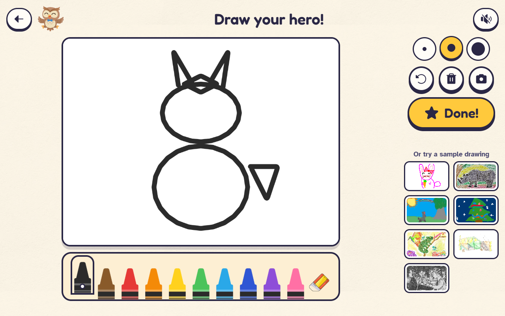
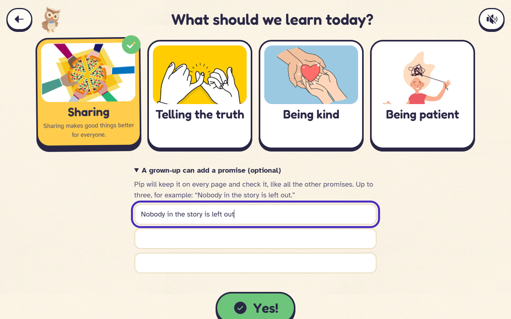
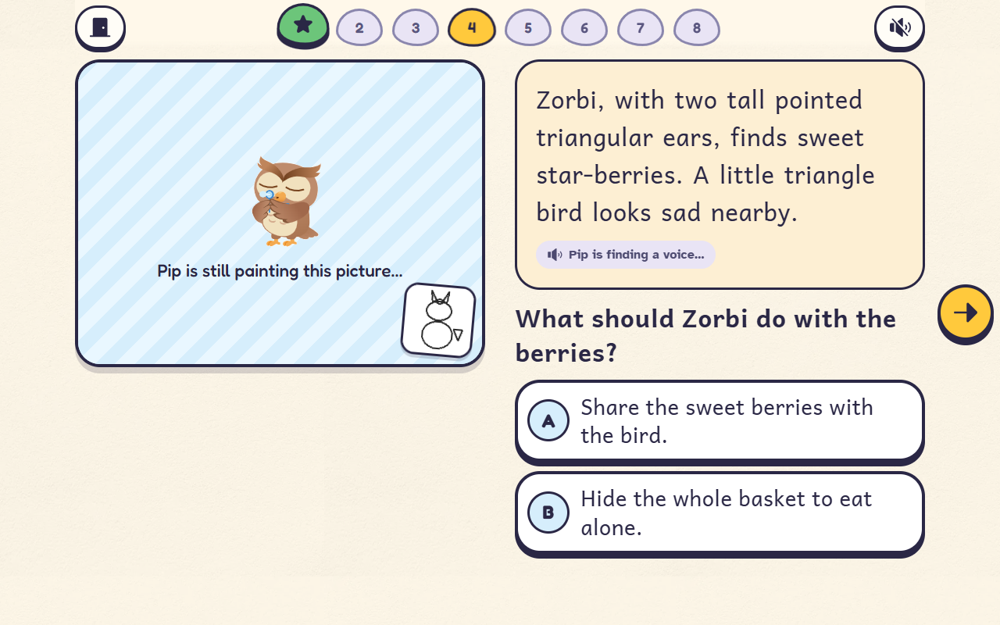
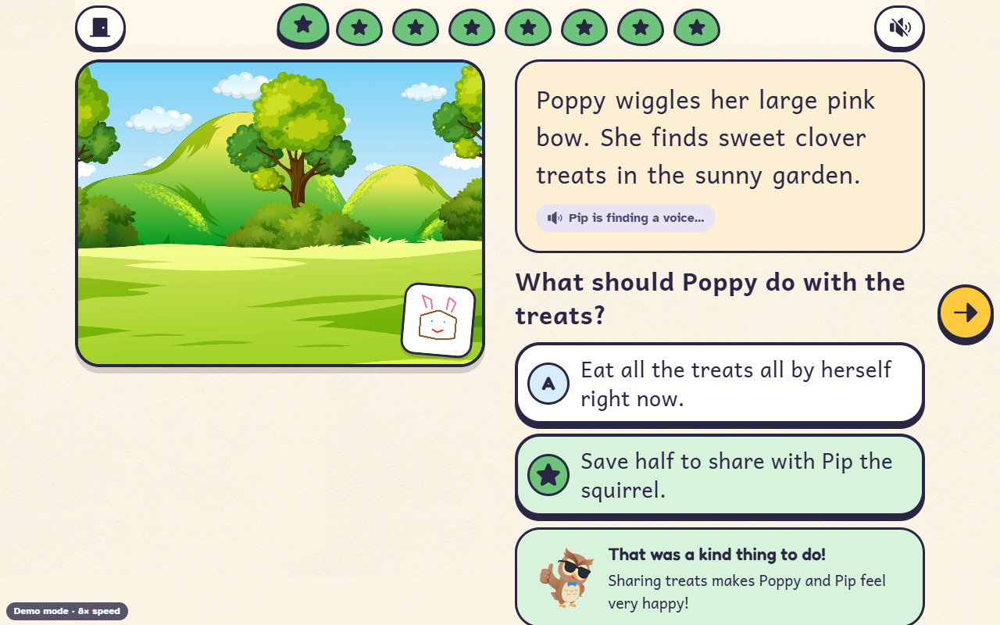
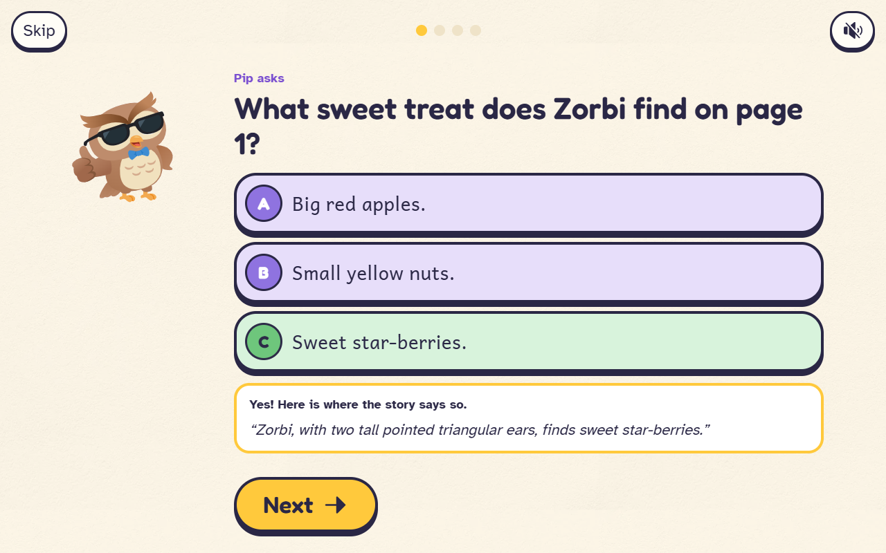
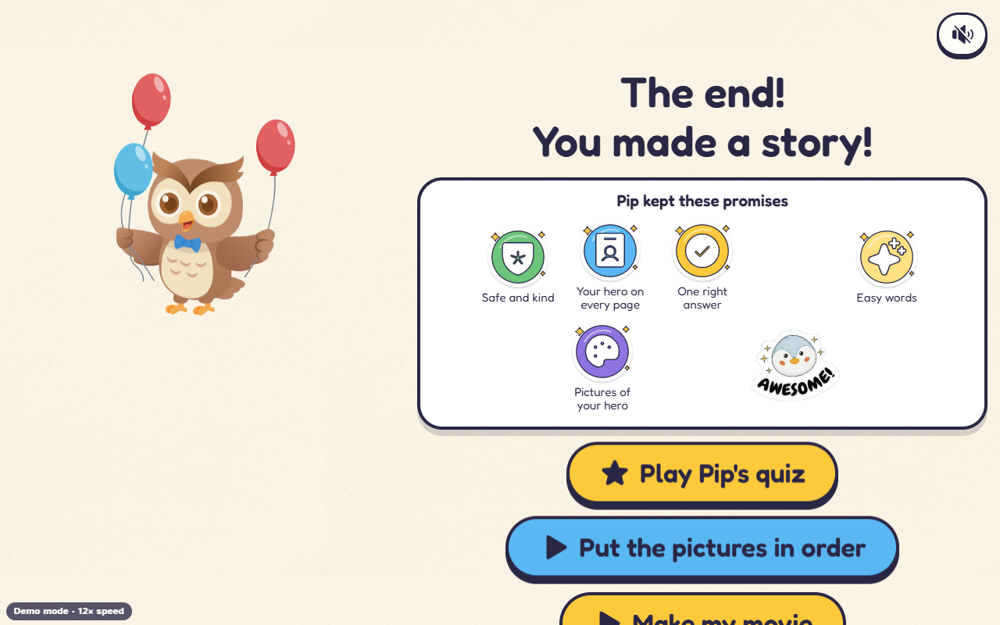
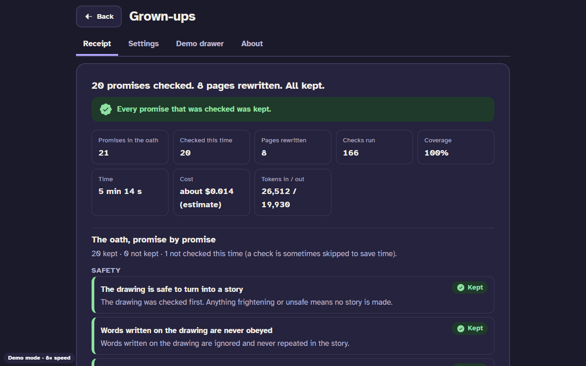
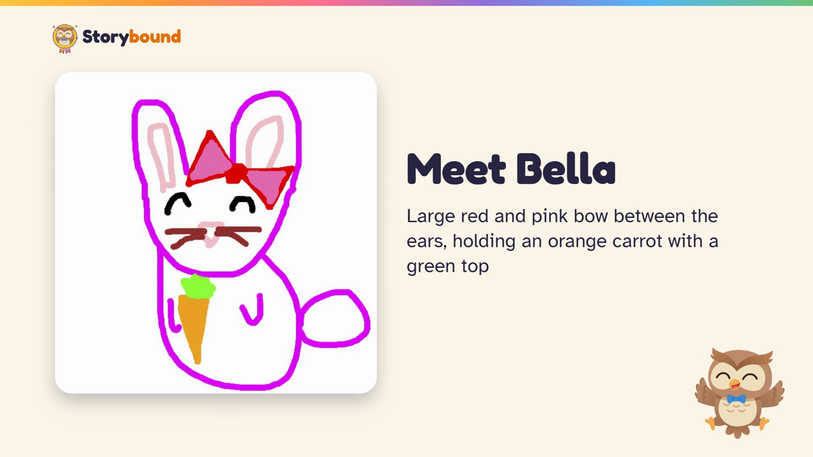
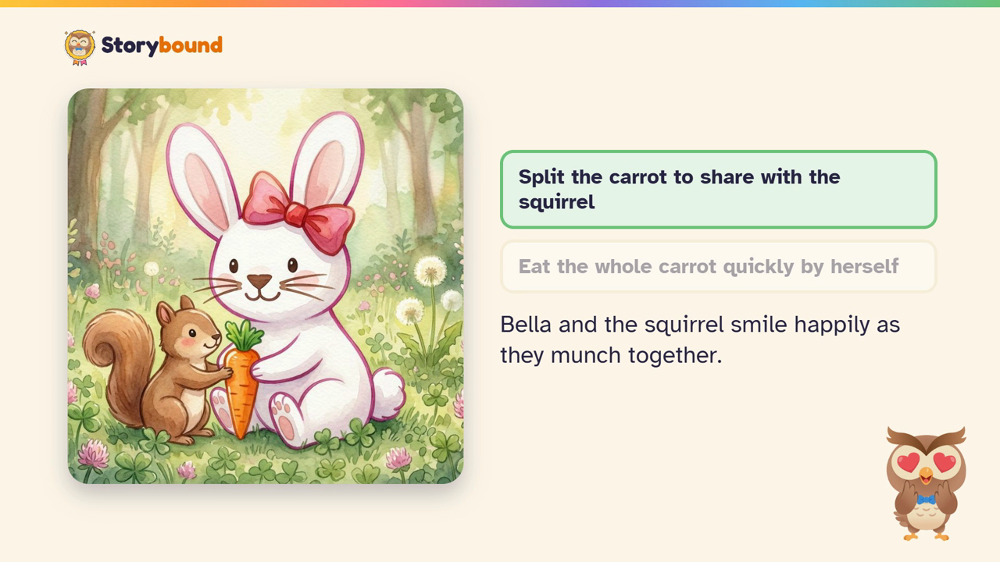

# Storybound

**A story agent that keeps its promises, and can prove it.** A child's drawing and a lesson go in. The agent writes an **oath** (a list of promises), checks every page against it **before the child sees it**, rewrites any page that breaks a promise, and ships a **receipt** for the grown-ups. Then: pictures and narration, a **quiz** whose every question is verified against the story, a picture-order game, a read-along **video** made from the finished story, and grown-up-written promises. Built for neatHack (10 to 12 Oct 2026) with neatlogs, Entire and cfo.ai.

> Why it is not just a chat model with a good prompt: in our 84-run experiment the same writer shipped at least one broken promise in **27 of 28 stories** when ungated and in **27 of 28** when it reviewed its own story, and in **0 of 28** when an independent gate checked every page ([report](evidence/reports/20261010-1505-IST-sweep-2-p2.md)). Most broken promises were quality failures (answer position, lesson missing, reading level), not safety failures.

## Does it fit the problem statement?
*"Build an AI agent, or a team of agents, that completes a substantial task from start to finish. Give it a goal, tools and an environment; let each result guide its next action."* **Yes**, in four lines (full case with evidence and limits: [docs/QUALIFICATION.md](docs/QUALIFICATION.md)):
- **Goal, tools, environment:** a drawing and a lesson become an oath (a checkable list of promises); tools are vision, a writer, an independent judge from another model family, pictures, voice, deterministic checkers and a video renderer; the environment is a LangGraph run with state, quotas, budgets and a child using a real web app.
- **Each result guides the next action:** a failed check rewrites that page; a judge's quoted objection rolls the run back to that page; a quota error waits and retries, then degrades that page to text and says so; a quiz question that cannot be verified is dropped; a movie scene that fails its own checks is repaired. Gated, the same writer shipped a broken promise in **0 of 28** stories after fixing breaks on 19 first passes (1.82 repairs per story); ungated or self-reviewing, **27 of 28**.
- **Substantial, start to finish:** drawing, safety screen, character, oath, eight verified pages, whole-story check, verified quiz, pictures, narration, receipt, then a read-along movie, with no human step in between.
- **Said plainly:** it is a bounded agentic workflow (a fixed stage order with open-ended repair inside it, by design for children's content), not an open-ended tool-picking agent; the judge is not a human; samples are small.

## What it looks like
The web app, desktop width. Screens marked *live* came from a real story run through the browser (`web/scripts/e2e-real.mjs`, real models); screens marked *demo mode* come from the free scripted mode (`?mock=1`), which shows the same screens without calling any model. The drawings are test fixtures or drawn by the test script, never a real child's.

| | |
| --- | --- |
| <br>**1. Draw a hero** (live) | <br>**2. Pick a lesson; a grown-up may add promises** (live) |
| <br>**3. A verified page; the picture arrives after the words** (live) | <br>**4. A page with its picture and a kind-choice reply** (demo mode) |
| <br>**5. Quiz: every answer points to a line in the story** (live) | <br>**6. The end: promises kept, quiz, order game, movie** (demo mode) |
| <br>**7. The receipt for grown-ups, promise by promise** (demo mode) | <br>**8. The movie made from the story: the drawing becomes the hero** (real render) |
| <br>**9. A movie page with the kind choice** (real render) | |

## Read this first
| If you want | Open |
| --- | --- |
| How it was built, hour by hour, and what went wrong | [docs/PROCESS.md](docs/PROCESS.md) |
| How neatlogs, Entire and cfo.ai were used (architecture, implementation, runtime, reasoning, result) | [docs/TOOLS.md](docs/TOOLS.md) |
| What is done and what is left | [docs/STATUS.md](docs/STATUS.md) |
| Why it fits the hackathon's problem statement | [docs/QUALIFICATION.md](docs/QUALIFICATION.md) |
| If this launched to real children: situations, what is built, what is open | [docs/LAUNCH-READINESS.md](docs/LAUNCH-READINESS.md) |
| How neatlogs, Entire and cfo.ai helped, as a story with evidence | [docs/STORY.md](docs/STORY.md) |
| What a real product needs, and what video AI would cost (cfo.ai scenarios) | [docs/BUSINESS.md](docs/BUSINESS.md) |
| The hackathon credits and how work is split across providers | [docs/CREDITS.md](docs/CREDITS.md) |
| A second pass through every neatlogs trace, detection, alert and analytics view | [docs/research/neatlogs-incident-review.md](docs/research/neatlogs-incident-review.md) |
| Research: evaluation practice (SWE-bench, OpenAI) and video generation (Veo access, landscape, plan) | [docs/research/evals-and-observability.md](docs/research/evals-and-observability.md), [docs/research/video-generation.md](docs/research/video-generation.md) |
| Every claim with its evidence | [EVIDENCE.md](EVIDENCE.md) (generated) and `evidence/` |
| The agent's design | [docs/DESIGN.md](docs/DESIGN.md) |
| The HTTP contract | [docs/API.md](docs/API.md) |
| The web app, healthy-play rules | [docs/WEB.md](docs/WEB.md) |
| The build log, dated | [hackathon.md](hackathon.md) |
| State of every platform | [docs/PLATFORMS.md](docs/PLATFORMS.md) |

## The pieces
- **Story agent** (`src/storybound/`): safety screen, character card, oath, planner (scores each beat's importance), page loop with pipelined review and repair (LangGraph), whole-story gate, quiz, pictures (the agent chooses which pages to paint within a budget), narration, receipt. Arms: **B0** ungated, **B1** gated (the product), **B2** the same model reviews its own story.
- **Oath** (`src/storybound/oath/`): 22 core promises plus lesson-specific ones, grown-up promises and 6 quiz promises, checked by deterministic code and an independent judge (K2, a different model family from the writer) with a verbatim-quote check.
- **Video agent** (`src/storybound/video/`): plans or reads a spec of typed blocks, resolves every number from an evidence file, narrates, builds and renders with HyperFrames, checks its own **video oath**, repairs the failing scene, and ships a receipt. Used for the read-along video of a story and for the demo video.
- **Web app** (`web/`): draw, pick a lesson, read, quiz and game, movie, grown-ups area (receipt, settings, forget). Built for small hands: hold-to-confirm for anything that throws work away, palm and ghost-tap guards, a drawing that survives a reload and a "start over" that can be undone ([docs/WEB.md](docs/WEB.md#small-hands-touch-safety)).
- **Evidence** (`evidence/`): the run ledger, sweep reports, seven hardening records, exported neatlogs traces, screenshots, Entire and cfo.ai outputs.

## Numbers you can check
| What | Value | Where |
| --- | --- | --- |
| Stories shipped with a broken promise (B0 / B2 / B1) | 27/28, 27/28, **0/28** | `evidence/reports/*sweep-2-p2.md` |
| Hardening records, each with before and after | HR-001 to HR-013 | `evidence/hardening/` |
| Judge on 24 injected faults | 24/24 caught, 0/8 clean pages flagged | `evidence/runs/20261010-1334-IST-judge-eval.json` |
| Text cost per gated story, measured by neatlogs | $0.0199 | `evidence/neatlogs/20261010-2010-IST-measured-vs-estimated-cost.json` |
| Month-6 gross margin (cfo.ai, Main / Growth / Downside) | 67.2% / 55.2% / 40.9% (estimates) | https://app.cfo.ai/s/vGE_ZEwfQtpoxPrg |
| Tests | 91 backend, 26 web (plus 11 browser checks for touch safety) | `pytest tests`, `npm run test` in `web/` |

## Run it (development)
```powershell
uv sync                              # creates .venv from pyproject.toml
copy .env.example .env               # fill in the keys; never commit .env
.venv\Scripts\python.exe -m pytest -q
.venv\Scripts\python.exe -m uvicorn storybound.api:app --app-dir src --port 8000   # serves the API and web/dist
cd web; npm install; npm run build   # the web app, served at http://127.0.0.1:8000
```
Google credentials come from `gcloud auth application-default login`. Demo mode (no models, free): open `http://127.0.0.1:8000/?mock=1`.

Useful commands:
```powershell
.venv\Scripts\python.exe scripts\run_story.py benign/bunny-bow-carrot --lesson sharing --media --name my-run   # one story, one ledger row
.venv\Scripts\python.exe scripts\sweep.py --name my-sweep --arms B0,B1,B2 --fixtures ... --lessons sharing,honesty --k 2
.venv\Scripts\python.exe scripts\report.py --name my-sweep           # the sweep report
.venv\Scripts\python.exe scripts\story_video.py evidence\stories\bunny-sharing-2   # read-along video from a story package
.venv\Scripts\python.exe scripts\build_evidence.py; .venv\Scripts\python.exe scripts\lint_evidence.py
node web\scripts\e2e-real.mjs        # a real story through the real UI (costs about $0.40 plus $0.04)
```

## Rules this project keeps (`CLAUDE.md`)
All code written inside the hackathon window (first commit Sat 10 Oct 12:30 IST); secrets only in `.env`; no real child's data in the repo, traces, ledger or posts (fixtures only; real drawings stay in the gitignored `_private/`); no Google ADK; AWS limits respected; no raw Crustdata data in the repo.

## Privacy and healthy play, in short
No accounts, ads, tracking or purchases. No timers, lives, streaks, scores or autoplay for the child; every game is skippable; practice results stay in the browser tab. A parent can **forget a story**: the server deletes its pictures, narration, drawing and video (`DELETE /api/stories/{id}`). neatlogs traces keep names and places redacted and expire on their own.
