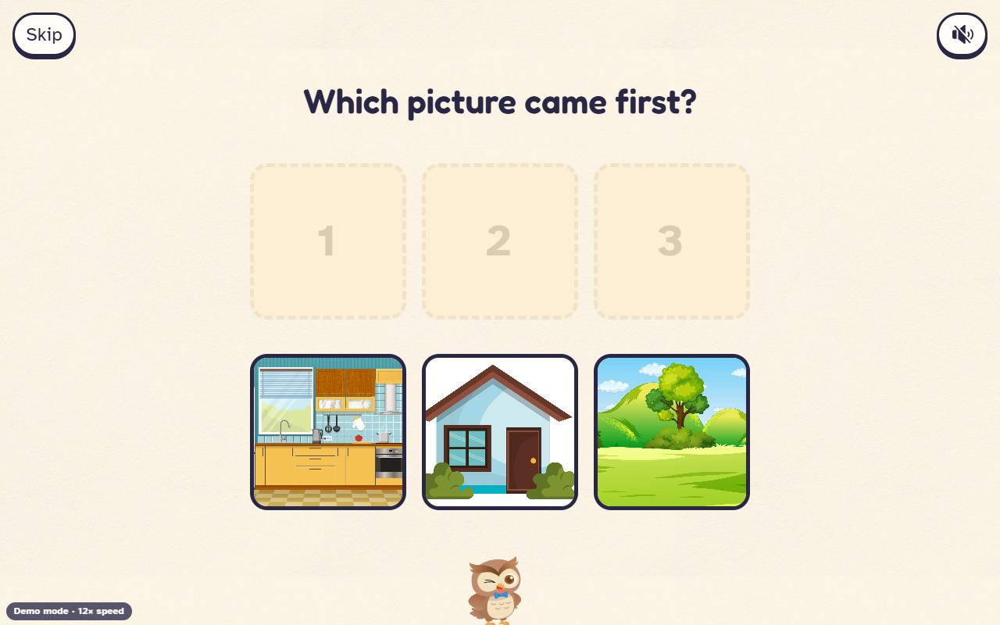

# Storybound web front end

React 18 + TypeScript (strict) + Vite, plain CSS with design tokens, Rive for Pip the owl. Lives in `web/`. The design is in
`docs/planning/frontend.md`; the contract is `docs/API.md`. Where they disagree with the backend (`src/storybound/api.py`,
`pipeline.py`) the backend wins; each such place has a short comment in `web/src/api/types.ts`.

## Screenshots
The main screens are in the README ([What it looks like](../README.md#what-it-looks-like)). The picture-order game (demo mode) is below. Larger sets are written to `web/shots/` (gitignored) by `web/scripts/e2e-real.mjs` and `web/scripts/e2e-quiz-mock.mjs`; the live ones used in the README are also kept under `evidence/screens/`.



## Run it

```
cd web
npm install
npm run dev          # http://127.0.0.1:5173, proxies /api to http://127.0.0.1:8000
npm run build        # type-checks, then writes web/dist (served by FastAPI at "/")
npm test             # Vitest: the event reducer
npm run shots        # Edge + puppeteer-core screenshots of every screen into web/shots (gitignored)
```

FastAPI mounts `web/dist` only if it exists when uvicorn starts, so restart uvicorn after the first build.

### Demo mode (no backend)

Add `?mock=1` to any URL (also used by tests and `npm run shots`). The app replays a recorded run:

| Query | Meaning |
| --- | --- |
| `mock=1` | demo mode on; a small "Demo mode" label shows bottom-left |
| `speed=10` | replay 10x faster (default 1 = real pace, about five minutes) |
| `scenario=bunny` | the recorded run, every page rewritten once (default) |
| `scenario=repair` | same run, only page 5 is rewritten (shorter, cleaner) |
| `scenario=degraded` | page 4 has no picture, page 6 no voice, judging switched off, words in the drawing ignored |
| `scenario=refuse` | calm refusal (`unsafe_image`) |
| `scenario=redraw` | redraw prompt (`too_small`) |

Without `scenario`, the choice follows the sample drawing picked: the grown-ups "Demo drawer" lists unsafe, caption and blank
samples; picking one plays the matching scenario. `src/mock/run-bunny.json` is the `events` array of
`evidence/runs/20261010-1318-IST-bunny-sharing-B1-first-full-run.json` (verdict objects trimmed to the fields the page uses).
That run had no pictures or audio, so `image.ready` / `audio.ready` (and their verdicts) are synthesised in
`src/mock/scenarios.ts` using the scene art and a silent mp3; the demo receipt is recomputed from the events, so its numbers are
consistent with what is replayed. The hero is always "Poppy" in demo mode (the recording's hero).

## Structure

```
web/src/
  api/      types.ts (wire shapes), client.ts (fetch + gentle retry), events.ts (SSE with reconnect, or the demo replay)
  state/    storyReducer.ts (pure: events -> UI state) + test, session.ts (screen names, focus), settings.ts (grown-up settings)
  screens/  Welcome, Draw, NameHero, PickLesson, Making, Reader, End, Refusal, Grownups (gate, tabs), Receipt
  components/  Pip (Rive + still), Btn, Stones, PromiseSheet, DrawCanvas, ConfirmPictures, Icon (Phosphor via CSS mask), ...
  mock/     run-bunny.json, scenarios.ts, mockApi.ts
  lib/      sound.ts, promises.ts (kid wording and sticker families), steps.ts (what Pip says), format.ts
  styles/   tokens.css, fonts.css, base.css, screens.css, grownup.css
web/public/assets/   only the art, sound, fonts and icons the app uses, copied by web/scripts/copy-assets.py (~4 MB)
```

Flow: Welcome -> Draw -> Name (optional) -> Lesson -> Making -> Reader -> End, plus the Refusal screen and a gated Grown-ups
area (receipt, settings, demo drawer, credits). The child's drawing lives only in memory (a blob URL); nothing is stored.

### How the event stream becomes screens

`storyReducer` folds each event (ignoring any whose `id` it has already seen, so a reconnect that replays from the start is
harmless). It tracks: the step Pip is on (looking, meeting the hero, writing/checking/fixing page N, painting, voice), accepted
pages, per-page picture and voice (`pending`, `ready` or `missing`), repairs, degradations, and each promise of the oath as
`waiting / checking / fixing / kept / kept_after_fix / not_kept / unchecked`. A page is shown only when everything for it exists (12 Oct): `pageReady` needs the page accepted, the whole-story check done (the
`story.verified` event, after which no page can change), its picture ready or given up on (`image.ready` or a `degraded` for it) and its
voice ready or given up on. Until then the child sees Pip's making screen (or "Page N is on its way!"), never a half-made page. The
backend starts each page's picture and narration as soon as the page is accepted, so the wait is the story's checking time, not the
sum of everything. A picture or voice that never comes (a `degraded` event, or the run ending) counts as settled and the page is
text-only. Each page then reads itself aloud 1.8 seconds after it opens (sound is on by default; nothing plays before the first tap on Welcome), so a child never has to find a button; the Listen button stays and becomes "Listen again" once the page has been read, for as many replays as anyone wants. The child's sticker sheet fills only when every checked promise in a family is kept; the
receipt shows everything, including promises not kept or not checked this time.

## Things found in the backend and assets (worth knowing)

- **`scene.repair` with `index: 0`** is a repair of the hero card or of the whole story, not a page. The UI says "Pip is polishing the whole story."
- **Story-gate rewrites are not re-sent.** `n_story_gate` can replace an accepted page, but only `scene.accepted` carries page text, so the
  reader can show the pre-rewrite text. Needs an event (for example a second `scene.accepted` for the page) or the final pages in `GET /api/stories/{id}`.
- Receipt: the backend sends `budget.usd_estimate` (API.md says `usd`), plus `broken`, `counts.checked`, `prompt_version`, `models`; all handled. There is no per-promise final status in the receipt: the UI derives it from `oath.ready` + `verdict` events + `broken`. A page reloaded later has no events, so the oath section would need the final status per promise in the receipt (or `GET /api/stories/{id}` to include the verdicts).
- Only four lessons exist (sharing, honesty, kindness, patience); the UI has card art for twelve and falls back to the lesson's Phosphor icon.
- Images arrive only after all pages are accepted (media phase), so during writing every page is text only. That is by design in the UI but worth knowing for the demo.
- `/api/fixtures` returns 26 files; benign ones are the child's "try a sample" row; `edge`, `synthetic`, `demo-unsafe`, `demo-text` are only in the gated Demo drawer, by name only (unsafe pictures are never loaded).
- There is no delete endpoint: "Forget this story" clears the browser tab only.
- **Asset problem:** all 20 files in `assets/art/crayons/` are byte-identical (one pink crayon). `copy-assets.py` recolours that one picture into the ten drawing colours.
- The Rive artboards have a white backdrop; an SVG filter in `index.html` turns near-white transparent so Pip sits on paper.

## Pip (Rive) inspection

Checked in Edge with the Rive runtime (`node web/scripts/inspect-rive.mjs`, `--bounds` for the crop box). All 13 shipped files load.
Each has a 500x500 default artboard named "Artboard" (the sunglasses and dizzy files also contain a helper artboard) and one looping
state machine, "State Machine 1", with **no inputs**: switching expression means loading another file, ~15 KB each. The owl occupies
roughly 40 to 60 percent of the artboard, so `src/components/pipCrops.json` stores each pose's measured box and `PipRive` scales to match the
still picture. Poses 03 (crying) and 08 (angry) are deliberately not shipped. Poses without a Rive file (check, comfort, paint, read) use the
supplied still composites. A still WebP shows first and stays if Rive fails or motion is reduced. The Rive runtime (~230 KB JS, 2 MB wasm) is
lazy-loaded and self-hosted; the runtime's CDN fallback is disabled.

## Small hands (touch safety)
A child on a tablet rests a palm, taps twice, swipes from the edge and pinches. None of that may change or delete the story. Rules, all in `web/src/lib/touchGuard.ts` unless noted:
- **Ghost taps:** clicks within 350 ms of a screen change are dropped.
- **Palms and resting hands:** a touch wider than 60 px is not a tap; three or more fingers down means a hand, and clicks are dropped for that moment; on the drawing a second finger never starts a second stroke; after the Apple Pencil was seen (hovering counts) touches on the drawing are ignored for 6 s. Safari does not report contact size, so there these two rely on the rules below.
- **Hold to confirm** (`HoldButton.tsx`): leaving a story, stopping the making and making another story ask with Pip, and the "yes" must be held for 0.9 s; "keep going" is a plain tap and has focus. Keyboard and screen-reader activation is immediate.
- **Nothing is final:** "Start over" clears at once and offers "Bring my drawing back"; undo is unlimited.
- **Reload-safe:** the drawing in progress (strokes only) is kept in this tab (`sessionStorage`) and the id of the story in progress too (`lib/resume.ts`); a reload picks the story up again from the server. Both are removed when the story starts (drawing) and by Forget.
- **No gestures of our own** and the browser's back swipe is held in place (`keepInApp`); pinch, double-tap zoom, long-press menus and dragging pictures are switched off outside text fields; the voice stops when the tab is hidden.
- Checks: `web/src/lib/touchGuard.test.ts` (7 unit tests) and `node web/scripts/e2e-touch.mjs` (11 behaviours through a touch-emulating browser, demo mode). Not tested: a real iPad, Safari, a real pencil.

## Quizzes and games: what they are and the rules they keep

After the last page a child gets (1) a short quiz about the story and (2) a "which picture came first?" game, then the end screen. Both are skippable and neither can be failed.

**Quiz.** Four questions made after the story is verified: two recall (a detail from a page, a different detail from another page), one feeling (why someone did something) and one lesson (why the kind choice was good). Every question must keep five promises before a child sees it (scope `quiz` in the oath): it quotes a line that is on the cited page word for word; it has three different answers and exactly one is right; its words fit the child's age; it is gentle; and a judge on every question confirms the story alone supports the right answer and no other. A fixed rule also stops the right answer being simply the longest. A question that cannot pass after two repairs is dropped, and a question the judge could not check is never shown. A wrong answer is not a penalty: it shows the line of the story that answers the question and lets the child try again.

**Picture-order game.** Three pictures from the story, shuffled; tap them in the order of the story. The answer is the order of the pages, so it is right by construction. A wrong tap wiggles back with a hint.

**Healthy-play rules (checked in review, not just promised).** No timers, lives, streaks, countdowns or scores shown to the child; no rewards for coming back, no loss when a child leaves; nothing starts by itself (no autoplay of the next story); no ads, accounts or purchases; every game can be skipped; after two stories in one sitting Pip suggests resting the eyes (a suggestion, never a lock); practice results stay in the browser tab and appear only in the grown-ups area ("Today's practice"), never on a server. These follow the NTIA recommended practices for industry (no streak rewards or other features that pressure minors to keep returning) and Common Sense Media's account of streak and loss mechanics as manipulative. A grown-up conversation card ("A grown-up can ask: ...") follows the dialogic-reading approach of prompting, evaluating and expanding with the child.

## Privacy and accessibility choices

No analytics, no third-party requests (checked by `npm run shots`, which fails the report on any request leaving the origin), fonts and art
self-hosted. Sound is off by default and nothing plays before a tap; the Welcome button unlocks audio. Touch targets are 56 px or more
(80 px for main buttons, with an invisible larger hit area). Visible focus rings, a screen-reader heading per screen that receives focus, `aria-live` for Pip's progress line,
alt text for pictures, labelled controls. `prefers-reduced-motion` and a "Calm motion" setting remove movement; the grown-ups area follows a dark
device setting, the child's world stays bright. The gate is hold-for-3-seconds (works with a held Space key) or a small sum.

## Verified, and not

Verified: `npm run build` (tsc strict, no errors); `npm test` (18 reducer tests: happy path, repair, refusal, degraded media, reconnect, honesty);
screenshots of every screen at 390x844, 820x1180, 1280x800 and 1180x820 in demo mode with no console errors, no failed requests and no external requests; the
dev proxy against the live backend for `GET /api/lessons` and `/api/fixtures` (no story was started).

Not verified: a real story end to end through the backend (it costs about six minutes and real money); real pictures and narration (the
recording has none); touch and stylus drawing and palm rejection on a real tablet (only mouse was driven); iOS audio unlock and the silent switch; Safari and Firefox; a screen reader pass; the
quiet music track was not listened to; SSE reconnect against a real dropped connection (the reducer side is tested, the browser side is not); a child using it.
